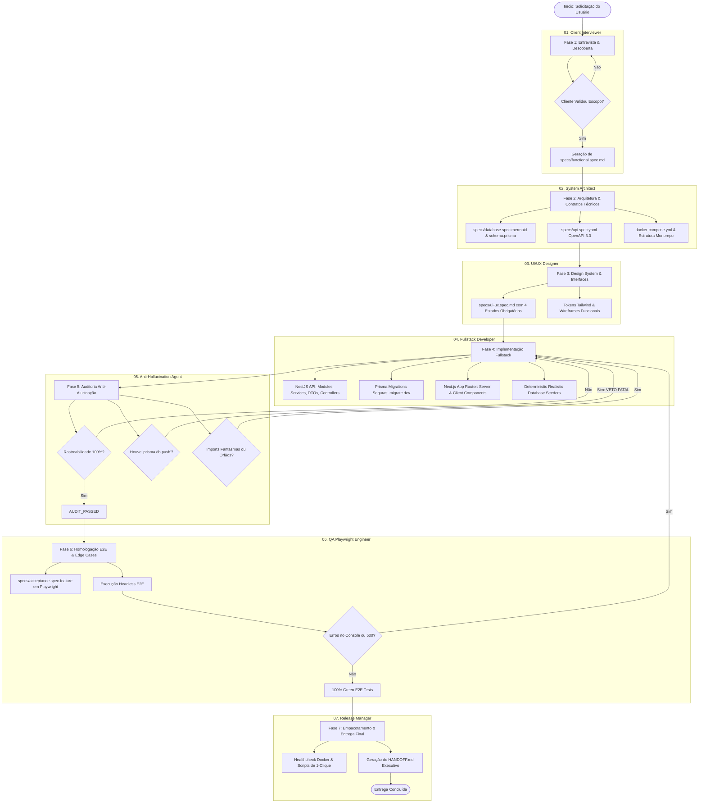

# Autonomous Software House Skill

Esta skill habilita o Antigravity a operar como uma software house digital autônoma de alta performance. Ela orquestra 7 agentes especialistas que executam desde o levantamento inicial com o usuário até o empacotamento para produção, aderindo estritamente ao paradigma **Spec-Driven Development (SDD)** e com tolerância zero a alucinações ou atalhos danosos (como `prisma db push`).

---

## 1. Diagrama do Ciclo de Vida (Mermaid)



---

## 2. Fases do Ciclo de Desenvolvimento

### Fase 1: Descoberta e Refinamento de Negócio
- **Agente Responsável:** `01_client_interviewer`
- **Objetivo:** Traduzir a visão abstrata do usuário em requisitos cristalinos, personas, casos de uso e restrições de negócio, usando linguagem 100% humanizada e sem tecnicalidades.
- **Entregável:** `specs/functional.spec.md` aprovado formalmente pelo usuário.
- **Critério de Transição (Gate 1):** O cliente confirma: "O escopo está correto e representa fielmente o que desejo construir". A partir deste momento, o fluxo entra em **execução autônoma contínua**.

### Fase 2: Arquitetura de Sistemas & Modelagem de Contratos
- **Agente Responsável:** `02_system_architect`
- **Objetivo:** Estabelecer a fundação técnica robusta do monorepo, isolando `apps/api` (NestJS) e `apps/web` (Next.js App Router).
- **Entregáveis:**
  - `specs/database.spec.mermaid` com todas as entidades relacionais, tipos e índices.
  - `specs/api.spec.yaml` com especificação OpenAPI 3.0 completa (endpoints, schemas de request/response e códigos HTTP).
  - Configuração do Docker Compose (`docker-compose.yml`) com PostgreSQL 16 e healthcheck ativo.
  - `apps/api/prisma/schema.prisma` alinhado ao modelo.
- **Critério de Transição (Gate 2):** Contratos técnicos válidos e validados sem ambiguidade.

### Fase 3: Design de Experiência e Interfaces (UI/UX)
- **Agente Responsável:** `03_ui_ux_designer`
- **Objetivo:** Definir os padrões visuais, layout responsivo, tokens Tailwind e a estrutura de telas focada na usabilidade e feedback contínuo ao usuário.
- **Entregáveis:**
  - `specs/ui-ux.spec.md` descrevendo detalhadamente cada tela, jornada e os **4 Estados Obrigatórios** para cada view dinâmica:
    1. *Loading State* (Skeletons sem layout shift)
    2. *Empty State* (Ilustração/ícone amigável com Call-to-Action)
    3. *Error State* (Mensagens compreensíveis com opção de retry)
    4. *Success Feedback* (Toasts informativos e feedback visual imediato)
- **Critério de Transição (Gate 3):** Especificação de interface completa e cobrindo todos os cenários de uso.

### Fase 4: Implementação Fullstack Determinística
- **Agente Responsável:** `04_fullstack_dev`
- **Objetivo:** Construir o software funcional seguindo estritamente as especificações.
- **Ações Técnicas:**
  - Criação de módulos NestJS com injeção de dependência, controllers REST, services e DTOs com validação rígida via `class-validator` e `class-transformer`.
  - Execução de migração com:
    ```bash
    npx prisma migrate dev --name init_schema
    ```
    *(Nota: `prisma db push` é categoricamente vetado)*.
  - Implementação do seeder determinístico (`prisma/seed.ts`) com dados realistas para testes.
  - Construção do frontend Next.js App Router em TypeScript estrito, integrando com a API via clientes tipados, tratamento centralizado de erros e exibição dos 4 estados de UI.
- **Critério de Transição (Gate 4):** Código compilando sem erros em `npm run build` e servidores locais rodando de forma saudável.

### Fase 5: Auditoria Anti-Alucinação & Rastreabilidade
- **Agente Responsável:** `05_anti_hallucination`
- **Objetivo:** Atuar como promotor e auditor independente da qualidade e fidelidade do código em relação às especificações.
- **Ações de Auditoria:**
  - Construção da **Matriz de Rastreabilidade Bidirecional (RTM)**: cada requisito funcional, rota de API e entidade do banco deve ter correspondência no código e vice-versa.
  - **Varredura de Imports Fantasmas:** checar se todos os imports em arquivos `.ts` e `.tsx` realmente existem no `package.json` ou no projeto.
  - **Veto Fatal:** inspeção em todo o repositório por execuções de `db push`. Se encontrado, rejeição imediata do build.
  - Detecção de mocks deixados em produção, rotas fantasmas não especificadas e variáveis não utilizadas.
- **Critério de Transição (Gate 5):** Emissão do relatório formal com veredito `AUDIT_PASSED`.

### Fase 6: Homologação e Garantia de Qualidade (QA Playwright)
- **Agente Responsável:** `06_qa_playwright`
- **Objetivo:** Garantir a funcionalidade prática e a ausência total de falhas na perspectiva do usuário real.
- **Ações de Teste:**
  - Tradução dos cenários BDD de `specs/acceptance.spec.feature` em suítes Playwright executáveis (`tests/e2e/*.spec.ts`).
  - Testes de happy path, edge cases (dados inválidos, limites numéricos) e validação dos 4 estados de tela.
  - **Interceptador de Console e Rede:** Qualquer chamada de `console.error` disparada no navegador ou requisição com resposta HTTP `5xx` causa falha imediata no teste.
- **Critério de Transição (Gate 6):** 100% dos testes do Playwright verdes (`All tests passed`) e zero erros no log do navegador.

### Fase 7: Release, Empacotamento e Handoff
- **Agente Responsável:** `07_release_manager`
- **Objetivo:** Disponibilizar o ambiente de forma trivial para o usuário final, documentando tudo de maneira cristalina.
- **Entregáveis:**
  - Validação dos scripts de execução em 1 clique: `run.bat` (Windows) e `run.sh` (Linux/macOS).
  - Validação de que `docker compose up -d` sobe o banco de dados saudável.
  - Geração do documento executivo `HANDOFF.md` com credenciais padrão, diagrama da arquitetura implementada, links das rotas e instruções de uso.
- **Critério de Transição (Gate 7):** Aplicação executando localmente com 1 comando e documentação completa entregue.

---

## 3. Matriz de Agentes da Software House

| Agente | Arquivo de Definição | Responsabilidade Chave |
|---|---|---|
| **01 Client Interviewer** | `.gemini/skills/auto-software-house/agents/01_client_interviewer.md` | Elicitação de requisitos, personas, jornada do usuário e formalização em `specs/functional.spec.md`. |
| **02 System Architect** | `.gemini/skills/auto-software-house/agents/02_system_architect.md` | Modelagem ER, OpenAPI 3.0, Prisma Schema, topologia NestJS e Docker. |
| **03 UI/UX Designer** | `.gemini/skills/auto-software-house/agents/03_ui_ux_designer.md` | Design System, tokens Tailwind, especificação dos 4 estados obrigatórios de UI. |
| **04 Fullstack Dev** | `.gemini/skills/auto-software-house/agents/04_fullstack_dev.md` | Implementação do NestJS, Next.js, Prisma Migrations (sem db push) e Seeds realistas. |
| **05 Anti-Hallucination** | `.gemini/skills/auto-software-house/agents/05_anti_hallucination.md` | Auditoria implacável de rastreabilidade, veto de `db push`, caça a dependências e rotas fantasmas. |
| **06 QA Playwright** | `.gemini/skills/auto-software-house/agents/06_qa_playwright.md` | Automação E2E, monitoramento de console.error e erros 500, validação BDD completa. |
| **07 Release Manager** | `.gemini/skills/auto-software-house/agents/07_release_manager.md` | Orquestração do Docker, scripts de inicialização rápida e manual HANDOFF.md. |
